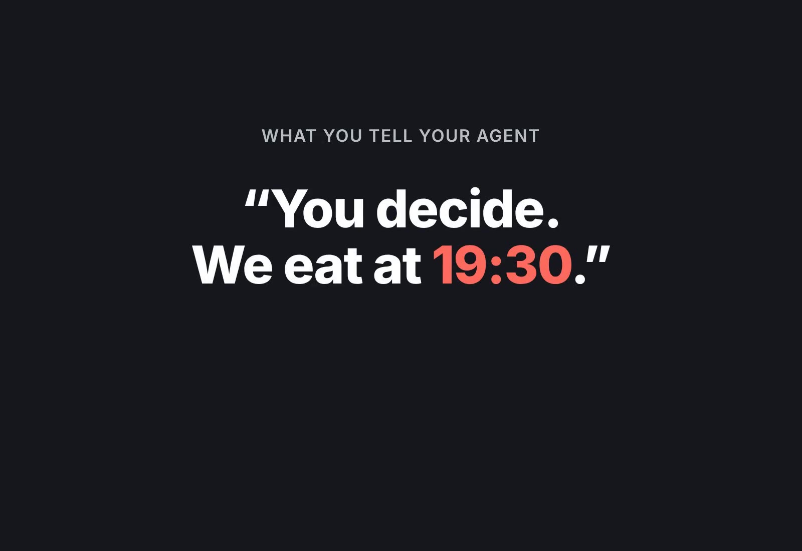
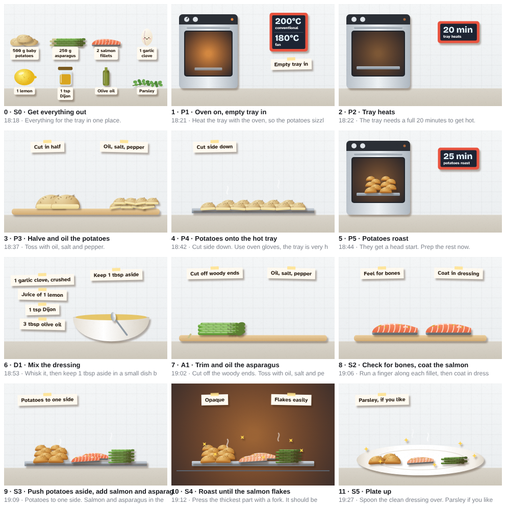

# cook-along

**Give your agent a recipe. Get back a one-page cook-along for your phone.**

cook-along is an agent skill. Say "you decide" when your agent suggests dinner, or paste a link, a PDF or a video transcript. The agent plans the meal like a head chef, then builds one page with:

- **The order, by the clock.** Worked out backwards from when you want to eat. Prep moves into the waits, and the last 20 minutes stay calm.
- **A picture for every step.** Paper cut-out animations with the amounts and temperatures on them. The text is one line.
- **What you need.** Ingredients by dish, the tools, and which ring and oven setting is used when.
- **A live "now" board and timers.** Every dish's status, what is next, and alarms. If a check fails ("still glassy: +3 min"), the page moves dinner and tells you what not to start.

[](docs/cook-along-demo.mp4)



## Why not just ask for a recipe card?

A recipe is written one dish at a time. You cook several at once, with one pair of hands, four rings and one oven. The hard part is the plan, not the picture.

So the skill splits the work:

1. **The agent writes a plan** (`plan.json`): every step with what it needs and makes, hands-on or waiting, which ring, pan or oven setting, how long, how long the result keeps, and how you know it is done.
2. **A scheduler checks it** (`scripts/plan.py`). It places each step as late as it can, slides prep into quiet moments, and flags what a person misses: a step that needs warm milk when nothing warms the milk, beans that would wait 5 minutes but keep for 3, two oven temperatures at once, a burger probed below 75°C, cups and °F.
3. **A fixed renderer builds the page** (`scripts/build.py`). The agent never writes drawing code, so every page looks right. The page is one file with its fonts inside it: it works offline and calls no other site.
4. **The agent looks at its work** (`scripts/check.py`): a contact sheet of every picture, plus phone and desktop screenshots.

## The drawings

Every picture is drawn in code, in a paper cut-out style. No images come from the web. The kit has 74 foods and tools across many cuisines: proteins, veg, rice, pasta, noodles, flatbreads, pulses, dairy and the cupboard. For a food the kit lacks, the agent looks it up (an image search) and describes it in the plan: a shape such as `long` or `mound`, and two colours. The page draws it from that.

## Install

Claude Code: copy `skills/cook-along` into `~/.claude/skills/`.
Claude apps: zip the `skills/cook-along` folder and upload it as a skill.

Needs Python 3. `check.py` also needs Playwright with Chromium (`pip install playwright && playwright install chromium`).

## Use

- "What should I cook tonight? You decide. We eat at 8."
- "Can you turn this into a cook-along?" plus a link, a PDF or a transcript.
- "OK, how do I make this?" after you agree a dish in chat.

The agent asks at most 5 questions (eating time, people, fan or conventional oven, rings, probe thermometer), and assumes sensible defaults if you are not there.

## Examples

Each folder has the plan and the built page. Open `index.html` in a browser.

| Example | Source | What it shows |
|---|---|---|
| [Salmon traybake](skills/cook-along/examples/salmon-traybake) | Basics with Babish, "Weeknight Meals" (2018) | One tray, one oven. The source's 52°C salmon changed to "opaque and flakes". |
| [Lamb dinner](skills/cook-along/examples/lamb-dinner) | A recipe written with ChatGPT | 4.5 hours, four dishes. A missing "warm the milk" step added. Prep moved into the roast. |
| [Burgers](skills/cook-along/examples/burger-dinner) | Patties from Turner & George, method written with ChatGPT | One pan used three times in turn. Buns toasted last. A probe check at 75°C. |

## How it was tested

Fresh agents used only the skill's own docs to plan recipes it had never seen: banana bread, chicken stir-fry, beef chilli for 6, a US mac and cheese written in cups and °F, pork dumplings on 2 rings, a Sunday roast chicken, a Thai green curry, bibimbap and shakshuka. Each one reported what was unclear or broken. Those reports drove the checks, the drawings and the docs. `tests/run.sh` keeps the checker honest: broken plans it must fail, and the examples it must pass.

## What it will not do

- Pretend the clock knows. Times are estimates. Every step has a done cue, and the checks decide.
- Plan below UK food safety guidance (Food Standards Agency). If a source does, the plan changes it and says why.
- Copy a source's words. Steps are rewritten, and every page names its sources and lists what changed.

The pages say so too: "Home recipe. Not professionally tested."

## Layout

```
skills/cook-along/
  SKILL.md               the workflow the agent follows
  references/            plan format, planning method, picture rules, safety rules
  scripts/               plan.py (schedule and check), build.py, check.py
  assets/                the renderer: page template, page script, drawing kit
  examples/              three finished plans and pages
  tests/                 broken plans the checker must catch (run tests/run.sh)
demo/                    the script that films the demo from the real example page
```

## Licence

Code: MIT (see LICENSE). Example plans and drawings: CC BY 4.0 (see LICENSE-examples). Fonts: SIL Open Font License 1.1 (see `skills/cook-along/assets/fonts`): Libre Caslon Display, Source Serif 4, IBM Plex Sans Condensed, IBM Plex Mono, Atkinson Hyperlegible and Bricolage Grotesque.
